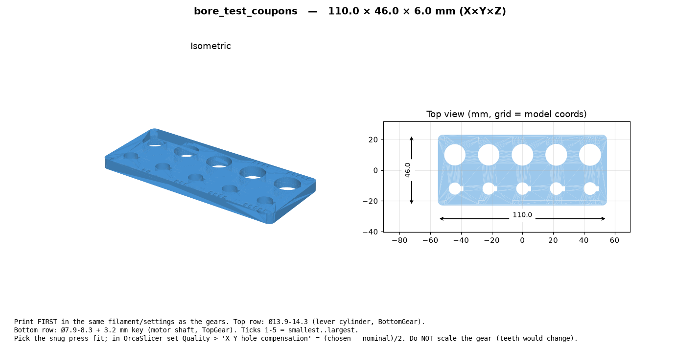
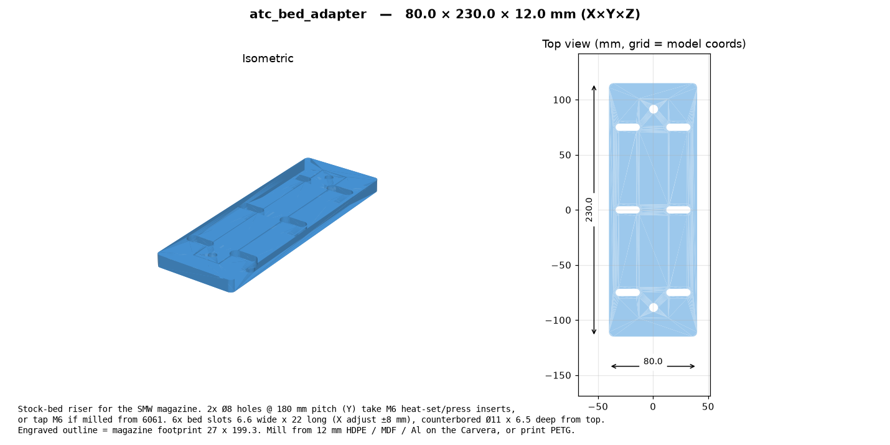

# Phase 1: Prototype Build Plan

**Goal:** a working 8-tool ATC on your Carvera Air as fast as possible. We replicate Warioo's proven design first. Then the machine makes its own upgrade parts (the "made by the CNC" requirement).

**Reference design:** Warioo, *Carvera Air ATC Mod* (Instructables, Feb 2026, last updated 2026-10-29). Summary: [`docs/research/SOURCE_SUMMARY.md`](../research/SOURCE_SUMMARY.md). Full PDF: `docs/research/` (local only).

> **License gate:** Warioo's files are **CC BY-NC-ND 4.0**. Use them for this personal prototype only. Do not sell them, modify-and-share them, or push them to GitHub. They live in `third_party/`, which is gitignored. The Phase 2/3 product will be an original design. See [`docs/LICENSING.md`](../LICENSING.md).

---

## How it works (60-second version)

```
 Spindle top (inside sheet-metal housing)
 ┌──────────────────────────────────────────┐
 │  NEMA17 + 50:1 gearbox  ── TopGear 24T   │  motor mount replaces the spindle top cover
 │                          │ HTD-5M belt    │  (425 mm, 85 T, 9 mm)
 │  lever cylinder ──────── BottomGear 24T  │  replaces the manual collet lever, 1:1 ratio
 │                           └ cam ─► roller microswitch (clamped/unclamped, NC = fail-safe)
 └──────────────────────────────────────────┘
 Machine already has:  "ATC motor" + "ATC sensor" cables in the head, a spare driver socket,
                       and firmware support (Carvera C1 logic) → `fset func 5`.
 Bed (far right):      8-pod spring magazine @ 20 mm pitch + M12 laser tool-presence sensor
```

The motor turns the same cylinder the manual lever turns, so it clamps and unclamps the collet. The community firmware runs the C1's ATC routine, with tool positions read from `custom_tool_slots.txt`.

---

## Step 0: Answer these first (5 min)

| # | Question | Why it matters |
|---|---|---|
| Q1 | **Which bed do you have?** Stock MDF, SMW fixture plate, or Funssor? | Upstream magazine bolts to **SMW only**. On a stock bed you also need `cad/custom/stl/atc_bed_adapter.stl` (designed here). |
| Q2 | Is the AD5M nozzle **hardened steel**? | PETG-CF wears out brass or stainless nozzles. If it isn't hardened, print in plain PETG. |
| Q3 | Size of your circular magnets? | The cover needs 3× **10 × 2 mm**. |
| Q4 | Current firmware version (`version` in MDI)? | You need the Community Firmware **≥ 2.1.0c-RC1**, and a dev build **≥ 2026-03-08** for `atc.detector.enable`. |
| Q5 | Do you own the 4th-axis module (and its driver)? | Upstream says you can borrow its DRV8825 for testing. |

Record the answers in `AGENTS.md → Open questions`.

---

## Step 1: Order parts (Day 0, critical path)

Full BOM with sources and LCSC numbers: [`bom/BOM.md`](../../bom/BOM.md) / [`bom/phase1_bom.csv`](../../bom/phase1_bom.csv).

**Order today, in this order:**
1. **Geared stepper 17HS15-1584S-MG50**: StepperOnline. This has the longest lead time (about 1–2 weeks to Ottawa).
2. **Laser sensor** (M12, 24 V, NPN): AliExpress GTRIC LS05-S12N1 (2–3 weeks), or an Amazon.ca equivalent (2 days).
3. **Amazon.ca Prime basket**: DRV8825, springs (0.4 × 4 × 17), JST-SM kit, M3 heat inserts, KW11 roller microswitch pack, PC817 module.
4. **Belt Gates 425-5M-09**: phone an Ottawa power-transmission distributor (BOM lists who). If they can't get it, order from Zoro or Amazon.
5. **Hardware store run (Home Depot / Canadian Tire)**: M3 countersunk 10–16 mm, M6×20, M4×10/12, CA glue. For the stock-bed adapter, also get M6 inserts and 6× M6 or M5 screws.
6. **Machinable stock (local)**: an HDPE cutting board (IKEA, Dollarama or Canadian Tire), 4–6 mm 6061 offcut (Metal Supermarkets Ottawa), 12 mm MDF.

Optional LCSC order (Phase 2 bulk and cheap spares): SS-5GL2 `C87120`, PC817C `C20612594`, PHR-6 `C157952`, SPH-002T `C111515`. Shipping to Canada is about 3–5 business days by DHL. LCSC is showing APEC-related delays this month, so use it for spares rather than the critical path.

---

## Step 2: Fetch and print (Day 0–2, while parts ship)

```bash
./scripts/fetch_upstream.sh                     # downloads STEP + tool slots + photos (gitignored)
.venv/bin/python scripts/step_to_stl.py third_party/warioo-atc/step third_party/warioo-atc/stl
```
OrcaSlicer can also import the `.step` files directly: **File → Import**, then pick the *Flashforge Adventurer 5M* profile.

### 2a. Calibrate bores first (≈25 min print)
Print `cad/custom/stl/bore_test_coupons.stl` in the **same filament and settings** you'll use for the gears.
- Top row (Ø13.9–14.3): the lever cylinder bore (nominal **14.06**) for BottomGear.
- Bottom row (Ø7.9–8.3 + 3.2 key): the motor shaft (nominal **8.1**) for TopGear.
- Pick the snug press-fit. In OrcaSlicer set **Quality → X-Y hole compensation = (chosen − nominal) / 2**. Do **not** scale the gears, because that changes the tooth pitch.



### 2b. Print list (upstream parts, measured)

| Part (STEP) | Size mm | Qty | Material | Orientation / supports | Notes |
|---|---|---|---|---|---|
| MotorMount | 61 × 69.5 × 53 | 1 | PETG-CF / PETG | Supports **on build plate only** (M4 counterbores) | 8 heat inserts go in afterward |
| TopGear_v2_3DPrint | Ø40 × 14.4 | 1 | PETG-CF | Teeth vertical, no supports | 8 mm keyed bore. Upgrade later: mill `TopGear_v2_milled_keyway` from Al |
| BottomGear | Ø42 × 22.6 | 1 | PETG-CF | Cam side up, no supports | 14.06 bore. Critical fit |
| ATCSensorMount | 19 × 38 × 64 | 1 | PETG-CF | Flat side down | Microswitch bracket |
| SMW_atcMagazine_v3 | 27 × 199.3 × 59.5 | 1 body + 8 pods (2 pcs each) | Body PETG-CF; pods PETG/PLA (contrast colour) | Body needs supports. Fits the AD5M diagonally (220 bed) | 33 solids in file. Split to parts in Orca (right-click → Split to objects) |
| SensorMount_GTRIC_M5 | 55 × 48 × 97 | 1 | PETG | As designed | For an M12 laser sensor |
| Cover | 35 × 69 × 210 | 1 (2 halves) | PETG | Each half flat | 3 magnets + glue; 2 index pins |
| Frontplate (optional) | 61 × 7.5 × 46.5 | 1 | any | flat | Customize later |

**AD5M starting settings (PETG-CF):** 0.4 hardened nozzle, 0.2 mm layers, **5 walls**, 40 % gyroid, nozzle 250 °C / bed 75 °C, 40–60 mm/s outer walls, part cooling 30 %, dry the filament first (65 °C, 6 h). For gears, use 6 walls and 100 % infill on BottomGear and TopGear.

Total print time is roughly **14–18 h**, mostly the magazine (~8 h) and cover (~4 h).

### 2c. Our custom parts (original, safe to commit or sell)

| File | Purpose |
|---|---|
| `cad/custom/stl/atc_bed_adapter.stl` | **Only for a stock bed.** An 80 × 230 × 12 riser plate. 2× Ø8 holes at **180 mm** pitch match the magazine. 6 counterbored slots fit any bed hole grid. Best made **on the Carvera** from 12 mm HDPE or 6061 (Step 7), or printed in PETG for the first install. |
| `cad/custom/stl/bore_test_coupons.stl` | Step 2a |
| `cad/custom/stl/magazine_chip_cap.stl` ×2 | Push-in caps for the magazine's Ø11 M6 counterbores, to keep chips out |
| `cad/custom/stl/signal_board_box.stl` + `_lid` | Enclosure for the 24 V sensor interface board |



---

## Step 3: Bench prep (Day 2–3)

1. **Heat inserts:** press the 8× M3 inserts into MotorMount.
2. **Microswitch:** drill its two mounting holes to **3 mm**, then solder leads to **COM + NC** (fail-safe: a broken wire reads as "triggered"). Crimp a **2-pin JST-SM male** on the end.
3. **Sensor interface board:** build it per [`electronics/inverter/README.md`](../../electronics/inverter/README.md) (PC817 version recommended). Test it on the bench with a 24 V supply before connecting it to the machine.
4. **Motor connector:** either crimp a JST-PH 6-pin to mate with the machine's "ATC motor" lead, or swap both sides to a 4-pin JST-SM like upstream did. **Upstream had to swap the inner two wires** to get rotation. Before crimping, check coil pairs with a multimeter (≈1–3 Ω within a pair).
5. **Magazine:** insert 3 springs per pod (24 total), then screw the pods down with the ring clamps. Tap each pod; it must spring back freely. If one binds, twist it or sand the tight spot. **Face the magazine bottom flat on the Carvera** (a 3–4 mm flat end mill skim pass). Upstream had layers delaminate when it was bolted to an uneven surface.
6. *(Optional)* **Bench test the motor and belt off-machine** using your **TB6600 + Pi Pico** (`firmware/pico/bench_stepper.py`). This confirms the motor and gearbox, and how much belt tension the parts need, before you open the head.

---

## Step 4: Install mechanics (Day N, ≈2 h, machine OFF and unplugged)

1. **Lever → BottomGear:** loosen the front and back set screws, pull the manual lever out, and make sure the cylinder screw into the spindle is tight. Press BottomGear onto the cylinder **with the cam pointing top-right**. Line up the diagonal hole with the old lever hole and secure it with **M6×20**.
2. **Motor:** fit the key to the gearbox shaft and press TopGear on. Keep a gap of ≤1 mm to the mount, with no rubbing. Bolt the motor to the mount with 4× **M4×12**, wires facing the back.
3. **Head:** remove the spindle top cover (4× M3 countersunk screws; keep them). Pull out the cables labelled **ATC motor** and **ATC sensor**.
4. **Belt and mount:** place the mount inside the housing with the motor shaft pointing **left**. Loop the belt over BottomGear, then tilt the mount (shaft down, motor raised) to slip it over TopGear. Press the mount down to tension the belt and reuse the 4× M3 screws. Tip: start the left-side screws loosely first, then lever the mount into tension.
5. **Switch bracket:** mount the ATCSensorMount with the switch (cable-tied) using 2× **M4×10**. Start it in the **lowest** position; you'll adjust it in Step 6.
6. **Driver:** insert the **DRV8825** in the spare (right) driver socket, oriented like its neighbours. Set **VRef ≈ 0.55 V** (formula `VRef = 0.5 × Imax / 2`; upstream found 0.55 V reliable for a 1.58 A motor). Adjust it with the machine on and a ceramic screwdriver.
7. **Magazine:** SMW bed → 2× **M6×20** straight in. Stock bed → bolt `atc_bed_adapter` to the bed through its slots, then the magazine into the adapter's M6 inserts. Push in the chip caps.
8. **Laser sensor:** mount it on SensorMount and aim it just **under the magazine lip**. Wiring: sensor +24 V and GND from the PSU, then sensor signal → interface board → the **yellow wire of the 4-pin EXT connector** (left side of the mainboard), which is cut and re-terminated. This is input **0.21**.

---

## Step 5: Firmware (≈30 min)

Install the Community **Firmware** and **Controller** (≥ 2.1.0c-RC1; latest dev for `atc.detector.enable`):
<https://github.com/Carvera-Community/Carvera_Community_Firmware> · <https://github.com/Carvera-Community/Carvera_Controller>

Then paste the commands from [`firmware/config/atc_setup_commands.txt`](../../firmware/config/atc_setup_commands.txt). **Run `model` first and record the second number after `CA1`**, because you need it to revert. Copy [`firmware/config/custom_tool_slots.txt`](../../firmware/config/custom_tool_slots.txt) to the root of the SD card.

---

## Step 6: Calibrate and test (≈1–2 h)

Follow the checklist in [`docs/phase1/TEST_CHECKLIST.md`](TEST_CHECKLIST.md): jog clamp and unclamp with the main-button long press, then adjust the switch bracket height so the cam trips the roller exactly at the end of unclamp. Next, teach each slot's X/Y/Z: jog an empty holder into pod 1, read the machine coordinates, and set the 20 mm pitch for the rest. If you used the adapter, Z rises by its thickness (12 mm). Run M6 T1…T8 dry runs **with no spindle rotation**, then real tool changes.

---

## Step 7: The Carvera makes its own parts ("made with the CNC" requirement)

Once it changes tools reliably, have the machine replace printed parts with machined ones:

| Order | Part | Stock | Why |
|---|---|---|---|
| 1 | Face magazine bottom flat | The printed magazine | Upstream recommends it; prevents delamination |
| 2 | **atc_bed_adapter** (stock-bed users) | 12 mm HDPE cutting board or 6061 | Stiffer, flat, permanent. Tap M6 in Al |
| 3 | **TopGear milled keyway inlay** (Ø28 × 4) | 4 mm 6061 | Upstream v2: a metal key seat stops the printed keyway wearing |
| 4 | Magazine body, machined | 2× 19 mm HDPE laminated, or epoxy tooling board | Phase 2 candidate: no layer lines, chip-proof, sellable |

CAM: use **Carvera Controller → MakeraCAM** with the STEP or STL of our own parts. Phase 2 adds proper machinable geometry (fixtures and tabs) for each part.

---

## Done criteria (Phase 1 exit)
- [ ] 50 consecutive tool changes T1↔T8 without a fault
- [ ] Tool-presence sensor catches a missing or unclamped tool
- [ ] Real job with ≥3 tools completes
- [ ] Notes logged in `docs/phase1/BUILD_LOG.md`: what was hard, fits, times, and costs. This becomes the Phase 2 input.
